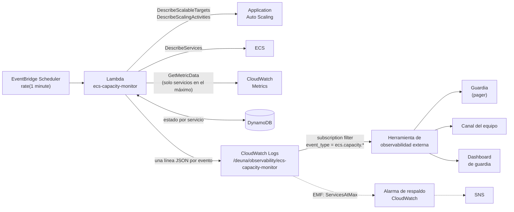
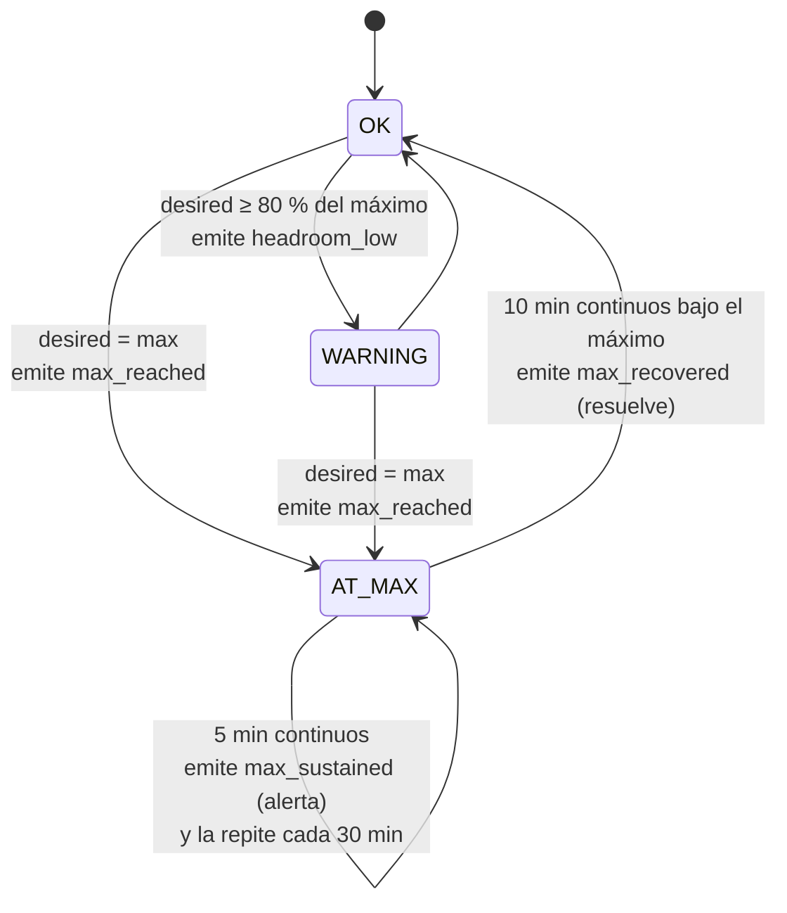

# Tarea 1 — Monitoreo de escalamiento de microservicios en ECS

Solución para **detectar, alertar y visualizar** cuándo un microservicio ECS llegó a su máximo de tareas, integrada con la herramienta de observabilidad externa que ingiere CloudWatch Logs.

| Carpeta | Contenido |
|---|---|
| `lambda/capacity_monitor.py` | Detector: lógica de estados, eventos y adaptadores AWS |
| `lambda/tests/` | 22 pruebas unitarias, sin AWS |
| `terraform/` | Módulo que despliega el detector, su estado, la programación y las alarmas de respaldo |
| `examples/` | Eventos reales generados por el código: alerta, snapshot y resumen de cluster |

## 1. El problema de fondo

AWS no avisa cuando un servicio llega a su máximo:

- **Application Auto Scaling no emite un evento** al topar con `MaxCapacity`. Solo registra una actividad "no escalada" que hay que consultar.
- **Los eventos de ECS en EventBridge** cubren despliegues, fallos de colocación y estado estable, no el techo de escalamiento.
- **CloudWatch no tiene una métrica de "máximo"**. `MaxCapacity` vive en el scalable target. Comparar `RunningTaskCount` contra un umbral fijo obliga a mantener una alarma por servicio y a actualizarla cada vez que alguien cambia el máximo.

Por eso la detección compara, en un solo lugar, la configuración de escalamiento con el estado real de cada servicio.

## 2. Arquitectura



## 3. Mecanismo de detección

Una Lambda corre cada minuto y hace cuatro pasos.

**1. Descubre los servicios.** `DescribeScalableTargets` en el namespace `ecs` devuelve todos los servicios con auto scaling de la cuenta y la región, con su `MinCapacity` y `MaxCapacity`. Un servicio nuevo queda cubierto sin configurar nada; si alguien cambia el máximo en Terraform, el siguiente minuto ya usa el valor nuevo.

**2. Lee el estado.** `DescribeServices`, en lotes de 10, devuelve `desiredCount`, `runningCount`, `pendingCount` y los tags del servicio.

**3. Clasifica.** Compara `desiredCount` contra el máximo:

| Estado | Condición | Ejemplo con máximo 10 |
|---|---|---|
| `AT_MAX` | `desired >= max` | 10 |
| `WARNING` | `desired >= ceil(max × 0.8)` | 8 o 9 |
| `OK` | resto | 2 a 7 |

Se usa `desiredCount` y no `runningCount` por dos motivos. Durante un despliegue `running` puede superar a `desired` (con `maximumPercent` de 200 %) y daría falsos positivos. Y si `desired` está en el máximo pero `running` no, el servicio igual topó: el auto scaling no puede pedir más tareas. Las tareas que no logran arrancar aparecen en `pending` dentro de la alerta.

**4. Agrega contexto solo a los servicios en el máximo:**

- `DescribeScalingActivities` con `IncludeNotScaledActivities=true`. Si en los últimos 10 minutos hay una actividad con motivo `AlreadyAtMaxCapacity`, el auto scaling **quiso escalar y el máximo lo bloqueó**. Esto separa "en el máximo y necesita más" de "en el máximo pero estable", y define la severidad.
- `GetMetricData` con el CPU y la memoria promedio de 5 minutos, en una sola llamada para todos esos servicios.

Las métricas de CPU y memoria no se usan para detectar: la política de escalamiento ya actúa al 60 %. Se incluyen para que quien recibe la alerta sepa de inmediato si el servicio está saturado por carga.

### Máquina de estados

El estado de cada servicio se guarda en DynamoDB. Los eventos se emiten **solo en transiciones**, no en cada minuto.



| Evento | Significado | Destino |
|---|---|---|
| `max_reached` | Llegó al máximo | Solo registro y dashboard |
| `max_sustained` | Lleva 5 min en el máximo. Se repite cada 30 min | **Alerta accionable** |
| `max_recovered` | Lleva 10 min por debajo del máximo | Resuelve la alerta |
| `headroom_low` | Entró en la franja del 80 % | Canal del equipo, sin pager |
| `snapshot` | Foto del servicio. Cada 5 min si está sano, cada minuto si no | Dashboard |
| `cluster_summary` | Conteo por cluster, en formato EMF | Dashboard y alarma de respaldo |

## 4. Integración con la herramienta externa

La herramienta ya ingiere CloudWatch Logs, así que ese es el punto de integración. **No hay dependencia de la API del proveedor**: cambiar de herramienta no requiere tocar el detector.

1. La Lambda escribe cada evento como **una línea JSON** en stdout.
2. Lambda envía esa salida a un log group dedicado, `/deuna/observability/ecs-capacity-monitor` (`logging_config` de Lambda), cifrado con KMS y con 30 días de retención.
3. Un **subscription filter** con el patrón `{ $.event_type = "ecs.capacity.*" }` envía solo los eventos del monitor al destino de la herramienta (Firehose o su forwarder). Las líneas `START`, `END` y `REPORT` del runtime no salen de CloudWatch. Si la herramienta ya suscribe log groups por prefijo, la variable `log_destination_arn` queda en `null`.
4. En la herramienta, el campo `event_type` define el tipo de evento y `dedup_key` agrupa y resuelve las alertas.

Las líneas `cluster_summary` usan **Embedded Metric Format**: CloudWatch extrae de ellas la métrica `Deuna/ECSCapacity ServicesAtMax` sin llamadas adicionales. Sobre esa métrica hay una alarma de respaldo por cluster, para el caso en que la herramienta externa no esté disponible.

### Quién vigila al vigilante

Si el detector falla, nadie se entera de que un servicio topó. El módulo crea dos alarmas en CloudWatch que no dependen de la herramienta externa:

- `ecs-capacity-monitor-errors`: la Lambda falla 3 de 5 minutos.
- `ecs-capacity-monitor-not-running`: la Lambda no se ejecutó en 5 minutos (`treat_missing_data = breaching`).

## 5. Contenido de la alerta

Generado por el código (`examples/max_sustained.json`), para el escenario de la tarea 4:

```json
{
  "event_type": "ecs.capacity.max_sustained",
  "schema_version": "1.0",
  "timestamp": "2026-11-16T07:47:00Z",
  "severity": "critical",
  "dedup_key": "ecs-capacity:production:core-prod/payments-processor",
  "environment": "production",
  "account_id": "333333333333",
  "region": "us-east-1",
  "cluster": "core-prod",
  "service": "payments-processor",
  "owner_team": "payments",
  "criticality": "tier-1",
  "capacity": { "min": 2, "max": 10, "desired": 10, "running": 10, "pending": 0, "utilization_pct": 100.0 },
  "at_max_since": "2026-11-16T07:42:00Z",
  "duration_seconds": 300,
  "demand_exceeds_max": true,
  "cluster_saturated": false,
  "metrics": { "cpu_avg_5m": 87.4, "memory_avg_5m": 61.2 },
  "message": "payments-processor lleva 5 min en su máximo de tareas (10/10). El auto scaling intentó escalar y el máximo lo bloqueó.",
  "links": {
    "runbook": "https://wiki.deuna.internal/runbooks/ecs-max-capacity",
    "dashboard": "https://observability.deuna.internal/d/ecs-capacity",
    "console": "https://us-east-1.console.aws.amazon.com/ecs/v2/clusters/core-prod/services/payments-processor/health?region=us-east-1"
  }
}
```

| Campo | Para qué |
|---|---|
| `message` | Lo que se lee en el pager: qué servicio, desde cuándo, y si el techo está limitando |
| `severity` | Enrutamiento: `critical` y `high` paginan, `medium` abre ticket |
| `dedup_key` | Una sola alerta por servicio y ambiente. `max_recovered` la cierra con la misma clave |
| `owner_team`, `criticality` | Salen de los tags del servicio ECS. Enrutan al equipo dueño |
| `capacity` | Números exactos. `pending > 0` indica tareas que no logran arrancar |
| `demand_exceeds_max` | `true`: hay demanda que no se atiende. `false`: está en el techo, pero estable |
| `metrics` | CPU y memoria. Alto: es carga. Bajo: el cuello está en otra parte (base de datos, dependencia externa) |
| `cluster_saturated` | Varios servicios topados a la vez: probable causa común |
| `links` | Runbook, dashboard y consola, a un clic |

`schema_version` permite evolucionar el formato sin romper los monitores de la herramienta.

## 6. Cómo se evita el ruido

| Técnica | Qué evita |
|---|---|
| **Ventana de 5 minutos** antes de alertar | Picos cortos en los que el auto scaling hace su trabajo. Llegar al máximo un momento no es un incidente |
| **Histéresis de 10 minutos** para resolver | Alertas que abren y cierran en bucle. Si el servicio sube y baja del máximo, cuenta como una sola saturación |
| **Eventos solo en transiciones**, con estado en DynamoDB | Una saturación de una hora genera 3 alertas (minuto 5, 35 y 65), no 60 |
| **`dedup_key` por servicio** | Los recordatorios actualizan la alerta abierta en lugar de crear otra |
| **Servicios de tamaño fijo excluidos** (`min == max`) | Un servicio que siempre está "en el máximo" por diseño |
| **Severidad según `criticality`** | `tier-1` pagina; un servicio interno abre ticket. Sin tag, `medium` |
| **Un nivel menos si `demand_exceeds_max = false`** | Servicios en el techo pero sin presión |
| **Agregación por cluster**: 3 o más servicios topados | Una tormenta de alertas. Pagina una alerta de cluster y las de servicio bajan a `medium` |
| **Aviso del 80 % al canal, no al pager** | Anticipar sin despertar a nadie |
| **Enrutamiento por `owner_team`** | Que la alerta llegue al equipo que puede actuar |
| **Solo producción pagina**, regla en la herramienta | Sandbox y development van al canal |
| **Snapshots cada 5 min** para servicios sanos | Volumen de logs y costo de ingesta en la herramienta |

Las pruebas verifican estos comportamientos: un pico de 3 minutos no pagina, el flapping produce una sola alerta, los recordatorios caen en los minutos 5, 35 y 65, y la recuperación necesita 10 minutos.

### Reglas en la herramienta externa

| Monitor | Condición | Acción |
|---|---|---|
| Servicio en el máximo | `event_type = ecs.capacity.max_sustained` y `environment = production` | Abrir o actualizar la alerta por `dedup_key`, con la severidad del evento |
| Recuperación | `event_type = ecs.capacity.max_recovered` | Resolver la alerta con la misma `dedup_key` |
| Cluster saturado | `event_type = ecs.capacity.cluster_summary` y `cluster_saturated = true` durante 5 min | Una alerta crítica por cluster |
| Poco margen | `event_type = ecs.capacity.headroom_low` | Mensaje al canal del equipo dueño |
| Detector caído | Sin `cluster_summary` en 5 min | Alerta al equipo de plataforma |

## 7. Dashboard de guardia

Pensado para responder en 10 segundos, a las 3 AM: ¿qué está topado, desde cuándo, y es carga o es otra cosa?

```text
┌──────────────────────────────────────────────────────────────────────────────┐
│ ECS · capacidad de servicios                      production ▾   últimas 6 h │
├────────────────┬────────────────┬────────────────┬───────────────────────────┤
│ EN EL MÁXIMO   │ POCO MARGEN    │ CLUSTERS       │ DETECTOR                  │
│      1         │      3         │ SATURADOS  0   │ último dato hace 40 s  ●  │
├────────────────┴────────────────┴────────────────┴───────────────────────────┤
│ SERVICIOS POR USO DEL MÁXIMO                                                 │
│ servicio             dueño     tier  tareas  uso    estado   desde   CPU  mem│
│ payments-processor   payments  1     10/10   100%   AT_MAX   7 min   87%  61%│
│ transfers-api        payments  1      9/12    75%   OK       -       58%  40%│
│ onboarding-kyc       growth    2      8/10    80%   WARNING  12 min  64%  35%│
├──────────────────────────────────────────────────────────────────────────────┤
│ USO DEL MÁXIMO EN EL TIEMPO (heatmap: servicio × hora)                       │
├───────────────────────────────────────┬──────────────────────────────────────┤
│ EVENTOS (reached / sustained /        │ LATENCIA p99 Y ERRORES DE LOS        │
│ recovered) en línea de tiempo         │ SERVICIOS EN EL MÁXIMO (desde APM)   │
├───────────────────────────────────────┴──────────────────────────────────────┤
│ MINUTOS EN EL MÁXIMO, ÚLTIMOS 7 DÍAS  →  candidatos a subir el máximo        │
└──────────────────────────────────────────────────────────────────────────────┘
```

| Panel | Fuente | Para qué |
|---|---|---|
| Contadores | Último `snapshot` por servicio, `cluster_summary` | Estado actual de un vistazo |
| Detector | Antigüedad del último `cluster_summary` | Saber si los datos son confiables |
| Tabla por uso del máximo | Último `snapshot`, más `metrics` de la alerta | Qué atender primero; CPU alto es carga, CPU bajo apunta a una dependencia |
| Heatmap | `snapshot.utilization_pct` | Patrones: picos diarios, quincenas, campañas |
| Línea de tiempo de eventos | `max_*` | Correlacionar con despliegues e incidentes |
| Latencia y errores | APM de la herramienta, por `service` | Saber si la saturación ya afecta a los clientes |
| Minutos en el máximo, 7 días | Conteo de `snapshot` con `status = AT_MAX` | Planificación: servicios con máximo demasiado bajo |

Consultas de referencia en CloudWatch Logs Insights. La lógica se traslada al lenguaje de la herramienta externa:

```text
# Tabla por uso del máximo
filter event_type = "ecs.capacity.snapshot"
| stats latest(desired) as desired, latest(max) as max, latest(utilization_pct) as uso,
        latest(status) as estado, latest(owner_team) as dueño by cluster, service
| sort uso desc

# Minutos en el máximo, últimos 7 días (los servicios en el máximo emiten un snapshot por minuto)
filter event_type = "ecs.capacity.snapshot" and status = "AT_MAX"
| stats count(*) as minutos_en_maximo by cluster, service
| sort minutos_en_maximo desc
```

## 8. Despliegue

El módulo `terraform/` sigue las mismas prácticas que la tarea 3 y se despliega con el mismo pipeline.

```hcl
module "ecs_capacity_monitor" {
  source = "./modules/ecs-capacity-monitor"

  environment              = "production"
  kms_key_arn              = module.kms.key_arn
  dashboard_url            = "https://observability.deuna.internal/d/ecs-capacity"
  runbook_url              = "https://wiki.deuna.internal/runbooks/ecs-max-capacity"
  log_destination_arn      = "arn:aws:firehose:us-east-1:333333333333:deliverystream/observability"
  log_destination_role_arn = "arn:aws:iam::333333333333:role/cwlogs-to-firehose"
  alarm_topic_arn          = "arn:aws:sns:us-east-1:333333333333:platform-oncall"
  fallback_alarm_clusters  = ["core-prod"]
}
```

Los servicios deben llevar los tags `owner` y `criticality` (`tier-1`, `tier-2`, `tier-3`). Se pueden exigir con una política de tags de AWS Organizations o con una regla de Checkov en el pipeline de cada servicio.

Si se usa la llave KMS de la tarea 3, hay que agregar `dynamodb` a su `allowed_via_services`.

### Seguridad

- La Lambda solo lee ECS, Auto Scaling y CloudWatch. Solo escribe en su tabla y su log group.
- `ecs:DescribeServices` está limitado a los servicios de la cuenta y región. Las acciones `Describe` de Auto Scaling y `GetMetricData` no admiten permisos por recurso.
- Las trust policies limitan el rol a la propia cuenta (`aws:SourceAccount`).
- Log group y tabla cifrados con KMS. Las variables de entorno no contienen secretos.
- `reserved_concurrent_executions = 1`: dos ejecuciones simultáneas no compiten por el estado ni duplican alertas.

## 9. Costo

Estimado para 100 servicios en producción, en us-east-1:

| Componente | Volumen mensual | Costo aproximado |
|---|---|---|
| Lambda (arm64, 256 MB, ~2 s) | 43 200 invocaciones, ~21 600 GB-s | < USD 1 (cubierto por el nivel gratuito) |
| APIs de ECS y Auto Scaling | Llamadas de lectura | Sin costo |
| `GetMetricData` | Solo servicios en el máximo | Centavos |
| DynamoDB on-demand | Escrituras solo en transiciones | Centavos |
| CloudWatch Logs | ~430 MB (snapshots cada 5 min) | ~USD 0,25 de ingesta |
| Métricas EMF | 2 por cluster, no por servicio | USD 0,60 por cluster |
| **Total en AWS** | | **~USD 2–5 al mes** |

El costo mayor suele ser la ingesta en la herramienta externa. Por eso los servicios sanos emiten un snapshot cada 5 minutos y no cada minuto, y el subscription filter descarta las líneas del runtime.

## 10. Alternativas descartadas

| Alternativa | Por qué no |
|---|---|
| Una alarma de CloudWatch por servicio sobre `RunningTaskCount` | El umbral cambia con cada servicio y con cada ajuste del máximo: es toil y deriva. Además depende de Container Insights, que cobra por métrica |
| Solo eventos de EventBridge | No existe un evento de "máximo alcanzado" |
| Alarmas `AlarmHigh` de target tracking | Indican CPU alto, no que el techo se alcanzó. Sirven como disparador adicional (ver abajo) |
| Integración directa con la API de la herramienta | Acopla el detector al proveedor y agrega una credencial. Los logs ya son el canal de ingesta |

## 11. Limitaciones y siguientes pasos

- **Latencia de detección**: hasta 1 minuto para el estado y 5 minutos para la alerta, por diseño. Para reaccionar antes, una regla de EventBridge sobre el cambio de estado de las alarmas `TargetTracking-*-AlarmHigh` puede invocar la misma Lambda fuera de calendario.
- **Un despliegue por cuenta y región.** Con varias cuentas, se despliega el módulo en cada una (por ejemplo con StackSets o el pipeline de la tarea 3), y todas escriben al mismo formato.
- **No verificado contra AWS.** Las pruebas cubren la lógica y el uso de las APIs con dobles de prueba. No se ejecutó contra una cuenta real.
- **Siguiente paso:** usar los "minutos en el máximo" para una revisión mensual de capacidad, y derivar el máximo de cada servicio del presupuesto de conexiones de la base de datos (ver tarea 4).

## Verificación

```sh
cd lambda && python -m unittest discover -s tests     # 22 pruebas
cd terraform && terraform init -backend=false && terraform validate
terraform test                                         # 5 pruebas en modo plan, sin cuenta AWS
```

Resultado en local: 22 de 22 pruebas de Python y 5 de 5 de Terraform pasan. `terraform validate`, `tflint`, `trivy` y `checkov` sin hallazgos, con 7 excepciones de Checkov justificadas en el código.

### Plan opcional en el pipeline

El job `plan` del workflow `tarea-1-monitoreo` corre `terraform plan` del módulo contra cada cuenta, con un rol de solo lectura y estado local vacío. Es opcional: un ambiente sin sus variables se omite con un aviso y el pipeline sigue en verde. Para habilitarlo, en **Settings → Secrets and variables → Actions → Variables** del repositorio:

| Variable | Valor |
|---|---|
| `AWS_PLAN_ROLE_ARN_<ambiente>` | Rol de solo lectura que GitHub asume por OIDC (el mismo de la tarea 3) |
| `TAREA1_KMS_KEY_ARN_<ambiente>` | Llave KMS del log group y la tabla de estado |

`<ambiente>` es `development`, `sandbox` o `production`. Son variables de repositorio y no de GitHub Environment: el Environment `production` exige aprobación, y un plan dentro de él esperaría esa aprobación en cada pull request.
