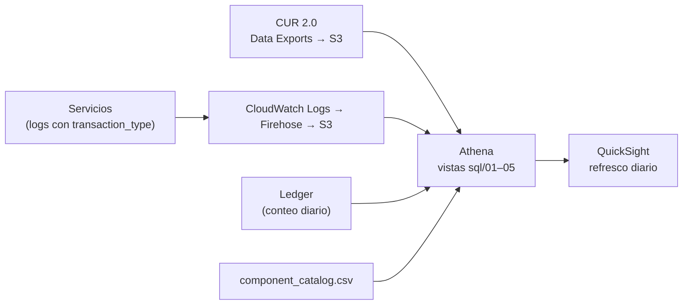

# Tarea 2 — Costeo por tipo de transacción

Solución automatizada para **identificar, distinguir y calcular el costo aproximado por transacción** monetaria y no monetaria, cuando la mayoría de los servicios AWS son compartidos entre ambos flujos.

**Principio de diseño: lo más simple que dé un número defendible.** Cinco servicios administrados, sin servidores propios, sin orquestador y sin tablas intermedias: el cálculo son vistas SQL que se evalúan al consultarlas.

| Carpeta | Contenido |
|---|---|
| `sql/` | Cinco vistas para Athena: costo amortizado, componentes, uso, costo por transacción y conciliación |
| `catalog/component_catalog.csv` | Catálogo de componentes: qué recurso es de qué flujo y con qué unidad se reparte |
| `tests/test_allocation.py` | 8 pruebas que ejecutan las vistas en DuckDB sobre un día de ejemplo |

## 1. La idea central

Los tags de costo de AWS funcionan **por recurso, no por petición**. Sirven para un Lambda que solo procesa transferencias, pero no para el cluster Aurora o el API Gateway que atienden a los dos flujos. Ahí el tag dice "compartido" y nada más.

Por eso la solución combina dos fuentes:

| Fuente | Qué aporta | Granularidad |
|---|---|---|
| **CUR 2.0** (facturación) | Cuánto costó cada recurso | Recurso, hora |
| **Telemetría** (logs de los servicios) | Cuánto usó cada tipo de transacción de cada recurso | Petición |

El costo de cada recurso compartido se reparte según la proporción de uso medida. Lo que no se puede medir se reparte como overhead, y la conciliación reporta cuánto fue, para que se sepa qué tan precisa es la cifra.



## 2. Etiquetado y propagación del tipo de transacción

### 2.1 Recursos: tags de costo

Todo recurso lleva tres tags, aplicados con `default_tags` y variables de Terraform (tarea 3):

| Tag | Valores | Ejemplo |
|---|---|---|
| `cost:component` | Nombre lógico del componente | `aurora-core`, `lambda-transfer-validator` |
| `cost:flow` | `monetary`, `non_monetary`, `shared` | `shared` |
| `cost:driver` | Unidad de reparto si es compartido | `db_time_ms`, `requests`, `gb_seconds`, `bytes`, `cpu_ms` |

Se activan como **cost allocation tags** para que aparezcan en CUR. `catalog/component_catalog.csv` identifica cada recurso por su ARN, así que también cubre lo que no admite tags (NAT, transferencia de datos) y los recursos que todavía no están etiquetados. Para ECS se activa **split cost allocation data**, una preferencia de facturación de la cuenta que lleva a CUR el costo de cada tarea.

### 2.2 Peticiones: el tipo viaja con la transacción

**Se clasifica una vez, en el borde, del lado del servidor.** El tipo se deriva de la ruta, nunca de un dato del cliente. Un cliente no puede declarar que una transferencia es "no monetaria".

| Punto | Mecanismo |
|---|---|
| **API Gateway** | Cada ruta tiene su tipo en Terraform. El mapeo de la integración fija el header `x-deuna-transaction-type` y genera `x-deuna-transaction-id`. Cualquier valor que mande el cliente se sobrescribe |
| **Entre servicios HTTP** | Cada servicio reenvía los dos headers en sus llamadas |
| **SQS** | Los mismos dos campos como `MessageAttributes`. El consumidor los lee al procesar el mensaje |
| **Lambda y ECS** | Cada línea de log estructurado incluye `transaction_type` y las unidades consumidas. Una función compartida del logger lo hace, para que ningún equipo lo implemente a mano |

### 2.3 Unidades de uso

La misma librería agrega a los logs que los servicios **ya emiten** las unidades consumidas. No se crean líneas nuevas, así que el costo extra de ingesta es casi nulo.

| Componente | Driver | Cómo se mide |
|---|---|---|
| API Gateway | `requests` | 1 por llamada |
| Lambda | `gb_seconds` | Duración × memoria configurada / 1024 |
| Aurora | `db_time_ms` | Tiempo de las consultas, medido por el cliente de base de datos |
| SQS | `requests` | Mensajes, en bloques de 64 KB (así factura SQS) |
| S3 | `bytes` | Bytes escritos y leídos |
| ECS compartido | `cpu_ms` | Tiempo de CPU de la petición |

## 3. Atribución de servicios compartidos

`sql/04_cost_per_transaction.sql` reparte el costo en tres capas, de la más precisa a la menos:

| Capa | Cuándo | Cómo se reparte |
|---|---|---|
| **Directa** | Recurso dedicado (`cost:flow` = `monetary` o `non_monetary`) | 100 % a ese tipo |
| **Por uso** | Compartido con driver medido ese día | Proporción de unidades de cada tipo |
| **Overhead** | Compartido sin driver (NAT, KMS, CloudWatch, compromiso no usado, sin catálogo) o sin telemetría ese día | Proporción del costo ya atribuido en las dos capas anteriores |

Después: **costo por transacción = costo total del tipo / transacciones del tipo**.

Decisiones:

- **Costo amortizado**, no facturado. Los Savings Plans y Reserved Instances se reparten sobre el uso que cubren. Si no, el costo unitario saltaría el mes de la compra.
- **El denominador viene del ledger**, la misma fuente que usa finanzas. Los logs pueden perder o duplicar líneas; los conteos no.
- **El numerador solo necesita proporciones.** Si la telemetría se muestrea de forma uniforme (por ejemplo, 10 %), el reparto no cambia. Así el costo de medir se mantiene bajo.
- **Nada se pierde.** Si un componente compartido no tuvo telemetría ese día, su costo pasa a overhead. La suma de lo atribuido siempre es igual al CUR.

### Ejemplo de un día

Es el escenario de `tests/test_allocation.py`. Costo amortizado del día: USD 550 (sin impuestos; la Lambda cubierta por Savings Plan entra a USD 40, no a 57,14).

| Componente | Costo | Capa | Monetaria | No monetaria |
|---|---:|---|---:|---:|
| Lambda `transfer-validator` | 40 | directa | 40,00 | — |
| Lambda `profile-updater` | 10 | directa | — | 10,00 |
| API Gateway (requests 30 / 70 %) | 100 | uso | 30,00 | 70,00 |
| Aurora (db_time 60 / 40 %) | 300 | uso | 180,00 | 120,00 |
| SQS (mensajes 90 / 10 %) | 20 | uso | 18,00 | 2,00 |
| S3 (bytes 80 / 20 %) | 10 | uso | 8,00 | 2,00 |
| *Subtotal atribuido* | *480* | | *276,00* | *204,00* |
| NAT + KMS + CloudWatch | 70 | overhead (276/480 · 204/480) | 40,25 | 29,75 |
| **Total** | **550** | | **316,25** | **233,75** |
| Transacciones (ledger) | | | 300 000 | 1 400 000 |
| **Costo por 1 000 transacciones** | | | **USD 1,054** | **USD 0,167** |

Una transacción monetaria cuesta unas **6,3 veces** más que una no monetaria. Aurora explica el 57 % del costo monetario, así que es la primera palanca de optimización.

## 4. Herramientas de AWS

| Herramienta | Uso |
|---|---|
| **CUR 2.0 (AWS Data Exports)** | Fuente de costo: costo amortizado por recurso, por hora, con tags. En Parquet a S3. AWS lo actualiza solo varias veces al día |
| **Cost allocation tags** + **split cost allocation data** | Tags de costo y costo por tarea ECS dentro de CUR |
| **CloudWatch Logs + Firehose** | Lleva a S3 los logs que los servicios ya emiten. Un subscription filter envía solo las líneas con `transaction_type` |
| **Athena** | Las cinco vistas de `sql/`. Las tablas usan *partition projection*, así que no hacen falta crawlers de Glue |
| **QuickSight** | Dashboard para finanzas y producto, con refresco programado de SPICE |

**Por qué no solo Cost Categories:** sus *split charges* reparten un costo compartido en proporción al costo de otras categorías o en partes iguales, pero no según una métrica de uso como el tiempo de base de datos. Sirven para la vista rápida en Cost Explorer; el costo por transacción necesita el uso medido.

## 5. Automatización

No hay pipeline que mantener. Cada pieza se actualiza sola:

| Paso | Cómo se automatiza |
|---|---|
| Costo | Data Exports escribe CUR en S3 varias veces al día |
| Uso | Firehose escribe la telemetría en S3 de forma continua |
| Transacciones | El ledger exporta un archivo diario de conteos a S3 (job existente de finanzas o un `UNLOAD` programado) |
| Cálculo | Son **vistas**: Athena calcula al momento de consultar. No hay tablas que cargar ni reprocesos |
| Publicación | QuickSight refresca SPICE todos los días a las 08:00 |
| Alerta de costo unitario | Alerta de umbral de QuickSight sobre el KPI: costo por 1 000 transacciones +20 % contra la media de 7 días |

- **Se publica el día D-2.** El costo de un día se estabiliza en 24 a 48 horas. Como el cálculo son vistas, cuando AWS cierra la factura del mes la cifra se corrige sola en el siguiente refresco.
- **Controles de calidad** (`sql/05_reconciliation.sql`). El dataset del dashboard solo muestra los días con `passed = true`: lo atribuido no difiere del CUR en más de 0,5 %, menos del 5 % del costo está fuera del catálogo y menos del 20 % se repartió como overhead. Un número que nadie puede defender es peor que ningún número.
- **Todo en Terraform**, con el mismo pipeline de la tarea 3: Data Export, bucket, tablas de Athena, Firehose y el dataset de QuickSight.

### Costo de la solución

| Componente | Costo aproximado al mes |
|---|---|
| Athena (Parquet particionado, MB por día) | Menos de USD 5 |
| Firehose | Unos USD 0,03 por GB. Con muestreo del 10 %, pocos dólares |
| S3 | Centavos |
| QuickSight | Según usuarios. Lectores con pago por sesión |

El principio: **medir no debe costar una fracción relevante de lo que se mide**. Por eso se reutilizan los logs existentes, se muestrea la telemetría y se evitan crawlers.

## 6. Presentación de resultados

El mismo dato, con tres cortes según quién lo lee.

### Finanzas: informe mensual

| Indicador | Ejemplo |
|---|---|
| Costo por 1 000 transacciones, por tipo | Monetaria USD 1,05 · No monetaria USD 0,17 |
| Variación contra el mes anterior | +3 % · −8 % |
| Costo total y volumen por tipo | USD 9 488 / 9,0 M · USD 7 013 / 42 M |
| Conciliación con la factura | 100 % del costo AWS atribuido, sin impuestos |
| Confianza del cálculo | 9 % directo · 78 % por uso · 13 % overhead |
| Margen unitario, si hay comisión | Comisión por transacción − costo AWS por transacción |

Dos aclaraciones que van siempre en el informe:

- Es **costo promedio con carga completa**, no costo marginal. Gran parte del costo (Aurora aprovisionado, NAT) es fijo. Una transacción adicional cuesta mucho menos que el promedio, y el costo por transacción baja al crecer el volumen.
- Es **costo de infraestructura AWS**. No incluye proveedores externos (switch de pagos, KYC) ni personas.

### Producto: qué explica el costo de cada flujo

- Composición por componente: "el 57 % del costo de una transacción monetaria es Aurora".
- Tendencia diaria con despliegues y campañas marcados, para ver qué cambio movió el costo.
- Palancas con su efecto estimado: por ejemplo, "mover las consultas de saldo a la réplica de lectura baja el costo no monetario en X %".

### Dashboard en QuickSight

```text
┌─────────────────────────────────────────────────────────────────────────┐
│ Costo por transacción                         noviembre 2026 ▾          │
├──────────────────┬──────────────────┬──────────────────┬────────────────┤
│ MONETARIA        │ NO MONETARIA     │ COSTO AWS TOTAL  │ CONFIANZA      │
│ USD 1,05 / 1 000 │ USD 0,17 / 1 000 │ USD 16 501       │ 87 % medido    │
│ ▲ 3 % vs. oct.   │ ▼ 8 % vs. oct.   │ conciliado ✓     │ 13 % overhead  │
├──────────────────┴──────────────────┴──────────────────┴────────────────┤
│ COSTO POR 1 000 TRANSACCIONES, DIARIO (dos líneas, con despliegues)     │
├────────────────────────────────────┬────────────────────────────────────┤
│ COMPOSICIÓN POR COMPONENTE         │ VOLUMEN VS. COSTO TOTAL            │
│ (barras apiladas por tipo)         │ (economías de escala)              │
├────────────────────────────────────┴────────────────────────────────────┤
│ DETALLE: día · tipo · directo · por uso · overhead · transacciones      │
└─────────────────────────────────────────────────────────────────────────┘
```

## 7. Limitaciones y siguientes pasos

- **Es una aproximación**, y el informe lo dice. El tiempo de consulta es un buen proxy del uso de Aurora, pero el almacenamiento no crece en proporción al tiempo. Performance Insights permite validarlo cada mes (ver el comentario SQL opcional más abajo).
- **Subtipos.** Conviene propagar desde el inicio `transaction_subtype` (recarga, pago, transferencia, retiro). Cuesta lo mismo y permite el mismo cálculo con más detalle.
- **Proveedores externos.** El modelo admite sumar costos que no vienen de AWS (por ejemplo, la tarifa del switch por transacción) como otra fuente de costo directo.
- **Cuándo agregar complejidad.** Si con meses de historia las vistas se vuelven lentas o caras de consultar, el siguiente paso es materializar el resultado diario en una tabla (Iceberg con `MERGE`, programado con EventBridge Scheduler). Hoy no hace falta: el volumen es de MB por día.
- **Validación con la base.** Si se necesita confirmar el reparto de Aurora, un comentario SQL con el tipo de transacción (`/* transaction_type='monetary' */`) lo hace visible en Performance Insights. Es opcional.
- **No verificado contra AWS.** Las vistas se probaron en DuckDB con datos de ejemplo. Los nombres de columnas de CUR 2.0 siguen la documentación de AWS Data Exports, pero no se ejecutaron contra un export real. El Terraform de la solución está descrito, no implementado.

## Verificación

```sh
pip install -r requirements-dev.txt
python -m unittest discover -s tests     # 8 pruebas
```

Resultado en local: 8 de 8 pruebas pasan. Verifican el costo amortizado, el mapeo del catálogo, las tres capas de atribución, los valores del ejemplo de arriba y la conciliación. También verifican que, sin telemetría de un componente, su costo pasa a overhead y el día no se publica.
