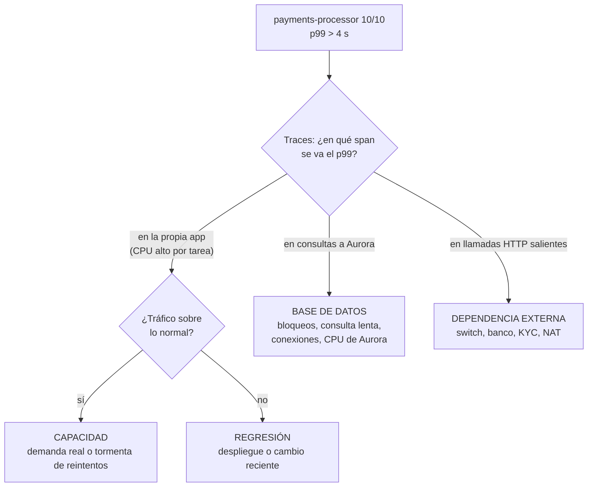

# Tarea 4 — Incidente en producción: `payments-processor` en 10/10 y p99 > 4 s

**02:47 AM.** La alerta de la tarea 1 avisa que `payments-processor` está en su máximo de tareas (10/10) y la latencia p99 supera los 4 segundos. La guardia escala el incidente.

Este documento describe cómo lo gestionaría de la detección al cierre. Las horas son de Ecuador (UTC−5).

## 0. Lo primero que hay que tener claro

**Que el servicio esté en 10/10 es un síntoma, no necesariamente la causa.** El auto scaling escala por CPU o memoria. Si `payments-processor` espera a una base de datos lenta o a un proveedor externo lento, las peticiones se acumulan, sube la memoria y el servicio escala hasta el techo, **sin que más tareas resuelvan nada**. En ese caso, subir el máximo empeora el problema: más tareas abren más conexiones a la base o mandan más llamadas a un proveedor que ya no responde.

Por eso la primera decisión no es "subir el máximo", sino **averiguar dónde se va el tiempo**.

## 1. Primeros 5 minutos: orientarse y organizarse (02:47–02:52)

| # | Acción | Para qué |
|---|---|---|
| 1 | Reconocer la alerta en el pager | Que la guardia sepa que alguien la tiene |
| 2 | **Medir el impacto en clientes**: tasa de éxito de pagos, errores 5xx, volumen frente a la misma hora de la semana anterior | Define la severidad. La latencia sola no dice si se pierden pagos |
| 3 | Declarar severidad. **SEV1** si fallan pagos o el éxito cae bajo el SLO; **SEV2** si solo hay degradación | Activa el protocolo correcto de comunicación y escalamiento |
| 4 | Abrir el canal del incidente y asignar roles: **Incident Commander** (yo), **comunicaciones**, y quien opere | Separar decidir, operar y comunicar evita errores a las 3 AM |
| 5 | **Preguntar qué cambió**: despliegues de las últimas 2 horas, pipelines de Terraform, feature flags, migraciones de base, jobs programados | La mayoría de los incidentes siguen a un cambio. A esa hora, los jobs batch son sospechosos |

```sh
# Estado, despliegues en curso y eventos recientes del servicio
aws ecs describe-services --cluster core-prod --services payments-processor \
  --query 'services[0].{desired:desiredCount,running:runningCount,pending:pendingCount,
           deployments:deployments[*].{status:status,taskDef:taskDefinition,created:createdAt,rollout:rolloutState},
           events:events[:10].[createdAt,message]}'

# ¿El auto scaling quiso escalar más y el máximo lo bloqueó?
aws application-autoscaling describe-scaling-activities --service-namespace ecs \
  --resource-id service/core-prod/payments-processor --include-not-scaled-activities --max-items 10
```

## 2. Diagnóstico: dónde se va el tiempo (02:52–03:05)

Tres hipótesis, revisadas **en paralelo** si hay más de una persona, y en este orden si estoy solo: es el orden de lo más rápido de descartar a lo más lento.



### 2.1 Capacidad o regresión en la aplicación

| Señal | Lectura |
|---|---|
| CPU por tarea alto (la alerta trae `cpu_avg_5m`), y el tiempo del trace está dentro de la app | La app es el cuello |
| Peticiones por segundo sobre lo normal | Demanda real (quincena, campaña) o abuso |
| Mucho tráfico de pocos clientes, o reintentos crecientes | **Tormenta de reintentos**: la latencia provoca reintentos, que suben la carga, que sube la latencia |
| Tráfico normal, pero CPU o memoria por petición más altos que ayer | **Regresión**: comparar con la versión anterior del task definition |
| `pending > 0` o eventos "unable to place" | Falta capacidad para arrancar tareas: cuotas de Fargate, IPs libres en las subnets |

### 2.2 Base de datos

| Dónde mirar | Qué busco |
|---|---|
| Performance Insights: carga frente a número de vCPU | Carga mayor que los vCPU: la base está saturada |
| Performance Insights: top wait events | `Lock:transactionid` o `Lock:tuple`: bloqueos. `IO:DataFileRead`: consulta sin índice o caché insuficiente. `CPU`: consultas caras |
| Performance Insights: top SQL | Una consulta nueva o un plan que cambió |
| `DatabaseConnections` y el pool de la app | Pool agotado: la app espera conexión antes de consultar |
| `CommitLatency`, `Deadlocks`, réplicas | Problemas de escritura o de lag |

Consultas, con el rol `dba-break-glass` (auditado; ver tarea 3):

```sql
-- ¿Qué esperan las sesiones?
SELECT state, wait_event_type, wait_event, count(*)
FROM pg_stat_activity WHERE datname = 'deuna'
GROUP BY 1, 2, 3 ORDER BY 4 DESC;

-- ¿Quién bloquea a quién?
SELECT blocked.pid AS blocked_pid, left(blocked.query, 80) AS blocked_query,
       blocking.pid AS blocking_pid, left(blocking.query, 80) AS blocking_query,
       now() - blocking.xact_start AS blocking_age, blocking.application_name
FROM pg_stat_activity blocked
JOIN LATERAL unnest(pg_blocking_pids(blocked.pid)) AS b(pid) ON true
JOIN pg_stat_activity blocking ON blocking.pid = b.pid;

-- Transacciones abiertas hace más tiempo
SELECT pid, application_name, now() - xact_start AS age, state, left(query, 100)
FROM pg_stat_activity WHERE xact_start IS NOT NULL
ORDER BY age DESC LIMIT 10;
```

### 2.3 Dependencia externa

| Señal | Lectura |
|---|---|
| Latencia y errores de los spans HTTP salientes, por proveedor | Cuál dependencia está lenta |
| Timeouts y estado de los circuit breakers | Si la app ya está protegiéndose o no |
| Página de estado del proveedor y su canal de soporte | Confirmación externa |
| `ErrorPortAllocation` en el NAT Gateway | Con muchas llamadas salientes, el NAT se queda sin puertos: parece un proveedor lento, pero es la red propia |

## 3. Mitigación sin downtime

La regla: **mitigar primero, buscar la causa raíz después**, y elegir la acción según el diagnóstico.

| Causa | Acción inmediata | Por qué no genera downtime |
|---|---|---|
| **Capacidad**, con la base sana | Subir el máximo de tareas (por ejemplo 10 → 16). Antes, verificar el presupuesto de conexiones de la base, la cuota de Fargate y las IPs de las subnets | Agrega tareas; las existentes siguen atendiendo |
| **Tormenta de reintentos o abuso** | Limitar por cliente en API Gateway o WAF. Priorizar pagos: bajar el límite de rutas no monetarias (consultas de saldo) | Protege los pagos a costa de lo menos crítico |
| **Regresión** | Volver al task definition anterior, o apagar el feature flag | Despliegue rolling: las tareas nuevas reemplazan a las viejas sin cortar el servicio |
| **Bloqueo en la base** | Identificar al bloqueador. Si es un job batch o una sesión ociosa, pausar el job y terminar esa sesión (`pg_terminate_backend`). **Nunca** una transacción de pago a medio confirmar | Libera las filas; las peticiones en espera continúan |
| **Base saturada de lecturas** | Mover lecturas a la réplica; agregar una réplica; con Serverless v2, subir el máximo de ACU | Ninguna de las tres reinicia el writer |
| **Dependencia externa** | Bajar timeouts y abrir el circuit breaker (fallar rápido con "reintente en unos minutos"); cambiar a proveedor secundario si existe; encolar para procesar después en los flujos que lo permiten | Corta la acumulación de peticiones y libera las tareas |

**Lo que no haría en caliente**, salvo decisión explícita del Incident Commander:

- **Escalar la instancia writer de Aurora.** Requiere failover, unos 30 segundos de corte. Es downtime, aunque breve.
- **Subir el máximo de tareas sin saber la causa.** Si el problema es la base o un proveedor, lo empeora.
- **Crear índices o cambiar el esquema** sin entender el plan de ejecución. `CREATE INDEX CONCURRENTLY` no bloquea, pero agrega carga a una base ya cargada.

### El cambio de emergencia y la infraestructura como código

Subir el máximo desde la CLI es más rápido que el pipeline de la tarea 3:

```sh
aws application-autoscaling register-scalable-target --service-namespace ecs \
  --scalable-dimension ecs:service:DesiredCount \
  --resource-id service/core-prod/payments-processor --min-capacity 2 --max-capacity 16
```

Ese cambio queda **fuera de Terraform**, y el siguiente `apply` lo revertiría en silencio. Por eso: se registra en el canal del incidente, y el mismo día se abre el pull request que lo codifica o lo revierte. El `terraform plan` diario sobre producción detecta la deriva si alguien lo olvida.

### Particularidad de una fintech: pagos en estado incierto

Con timeouts y reintentos puede haber pagos que **el proveedor procesó y nosotros no confirmamos**, o pagos duplicados. Durante el incidente:

- No reintentar pagos a ciegas. Los reintentos usan la llave de idempotencia de la transacción.
- Listar las transacciones en estado `pending` o `timeout` de la ventana del incidente.
- Conciliarlas con el proveedor antes de cerrar. El incidente no termina cuando baja la latencia, sino cuando **cada dólar está donde debe estar**.

## 4. Cierre

El incidente se resuelve cuando se cumple todo esto:

- p99 dentro del SLO durante 30 minutos seguidos.
- El servicio volvió por debajo del máximo (la tarea 1 emite `max_recovered`).
- Errores en su nivel normal y colas sin atraso.
- Conciliación de las transacciones afectadas iniciada, con responsable y fecha.
- Cambios de emergencia registrados, con su pull request abierto.

Después: monitoreo reforzado por 24 horas y postmortem agendado.

## 5. Comunicación

Una persona dedicada a comunicar, para que quien opera no tenga que hacerlo. Mismo hecho, distinto nivel de detalle según la audiencia.

| Audiencia | Canal | Frecuencia | Qué necesita saber |
|---|---|---|---|
| **Equipo técnico** | Canal del incidente | Cada 15 min, y en cada hallazgo | Hipótesis, evidencia, acciones, quién hace qué |
| **Producto y soporte** | Canal de producto y soporte | Cada 30 min | Qué funciones están afectadas, qué decirle al cliente, cuándo se espera solución |
| **C-Level** | Mensaje directo o llamada si es SEV1 | Al declarar, cada 60 min y al resolver | Impacto en clientes y dinero, riesgo, qué se está haciendo, próxima actualización |
| **Clientes** | Página de estado y app | Si el impacto es visible | Qué pasa, qué hacer, que su dinero está seguro |

### Plantillas

**Equipo técnico — 03:05**

> **[SEV1] payments-processor — actualización 3**
> **Estado:** mitigando.
> **Hallazgo:** el 70 % del p99 está en consultas a Aurora. Wait event dominante: `Lock:transactionid`. El bloqueador es el job `nightly-reconciliation` (pid 48211), con una transacción abierta desde las 02:31.
> **Acción en curso:** @operador pausa el job y termina el pid 48211 (confirmado: no es un pago).
> **Siguiente:** verificar la caída de la latencia en 5 minutos. No subir el máximo de tareas: la causa no es capacidad.
> **Próxima actualización:** 03:20.

**Producto y soporte — 03:10**

> **Incidente en pagos — 03:10**
> Desde las 02:47 los pagos y transferencias tardan más de lo normal (hasta 5 segundos) y cerca del 3 % falla. Recargas y consultas de saldo funcionan con lentitud.
> **Para soporte:** si un cliente reporta un pago fallido, que **no lo reintente**. Revisaremos y conciliaremos cada caso.
> **Estado:** identificamos la causa y estamos aplicando la corrección. Esperamos normalidad antes de las 03:30.
> **Próxima actualización:** 03:40.

**C-Level — 03:15**

> **Incidente SEV1 en pagos — en mitigación**
> **Impacto:** desde las 02:47, pagos lentos; cerca de 1 200 pagos fallidos de 40 000 (3 %), por unos USD 85 000. Ningún dinero perdido: los fallidos se concilian uno a uno.
> **Causa:** un proceso nocturno bloqueó la base de datos de pagos. Ya lo detuvimos.
> **Expectativa:** normalidad antes de las 03:30.
> **Riesgo:** bajo, si se cumple. Evaluaremos con Riesgo y Cumplimiento si aplica reporte al regulador.
> **Próxima actualización:** 04:15, o antes si cambia algo.

Las cifras y la causa de las plantillas son un ejemplo ilustrativo. En un incidente real salen del diagnóstico.

## 6. Postmortem

Sin culpables: se analiza el sistema y el proceso, no a las personas. Reunión dentro de 5 días hábiles, documento compartido antes.

### Contenido

| Sección | Contenido |
|---|---|
| **Resumen** | Tres líneas: qué pasó, impacto, causa |
| **Impacto** | Duración; pagos afectados y fallidos; monto; clientes; consumo del error budget del SLO |
| **Línea de tiempo** | Del primer síntoma al cierre, con los tiempos de detección, respuesta, mitigación y resolución |
| **Causa raíz y factores contribuyentes** | Con "5 porqués". Casi siempre hay más de un factor |
| **Qué funcionó, qué no, y dónde tuvimos suerte** | La suerte es un riesgo no controlado |
| **Acciones** | Cada una con responsable, prioridad, fecha y ticket. Clasificadas en detectar, mitigar y prevenir |
| **Seguimiento** | Revisión de las acciones abiertas en la reunión semanal de operaciones hasta cerrarlas |

### Acciones típicas para este escenario

| Tipo | Acción | Por qué |
|---|---|---|
| Detectar | Alerta por *burn rate* del SLO de latencia de pagos, en dos ventanas (5 min y 1 h) | Avisa por el impacto en el cliente, no solo por un síntoma de infraestructura |
| Detectar | Aviso al 80 % del máximo de tareas (ya incluido en la tarea 1) | Anticipa antes del techo |
| Mitigar | Circuit breakers, timeouts y bulkheads por dependencia, configurables sin desplegar | Mitigar en minutos, no en un despliegue |
| Mitigar | Runbook de "servicio en el máximo" enlazado desde la alerta, con el árbol de decisión de la sección 2 | La guardia no improvisa a las 3 AM |
| Prevenir | Escalar también por peticiones por tarea, no solo por CPU y memoria | Un servicio que espera I/O escala tarde o escala sin sentido |
| Prevenir | Derivar el máximo de tareas del presupuesto de conexiones de la base, y usar RDS Proxy | Que escalar la app no pueda saturar la base |
| Prevenir | Jobs batch fuera de la ruta crítica: réplica de lectura, transacciones cortas, `lock_timeout` | Que un proceso nocturno no bloquee pagos |
| Prevenir | Escalamiento programado para picos conocidos (quincena, fin de mes) y pruebas de carga trimestrales | Saber el techo real antes de que lo encuentren los clientes |
| Prevenir | Despliegues canary con rollback automático por alarmas (ECS deployment circuit breaker) | Una regresión se revierte sola |
| Prevenir | Game day trimestral con este escenario | Practicar el runbook antes de necesitarlo |

## 7. Relación con las otras tareas

- **Tarea 1** detecta el evento, trae CPU y memoria en la alerta para orientar el diagnóstico, y emite `max_recovered` como criterio de cierre.
- **Tarea 2** permite cuantificar el costo de las mitigaciones, por ejemplo cuánto cuesta subir el máximo de forma permanente.
- **Tarea 3** define el rol `dba-break-glass` para entrar a la base, y el pipeline por el que debe pasar todo cambio de emergencia.
